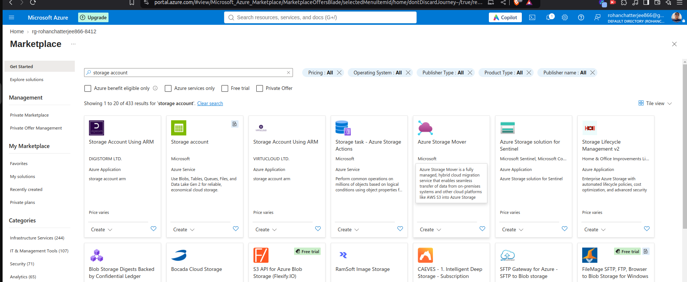
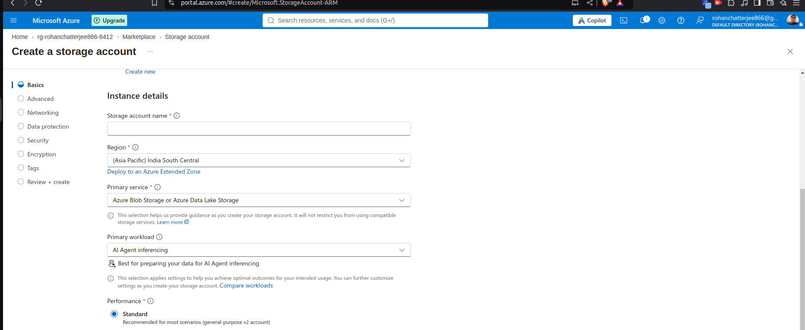
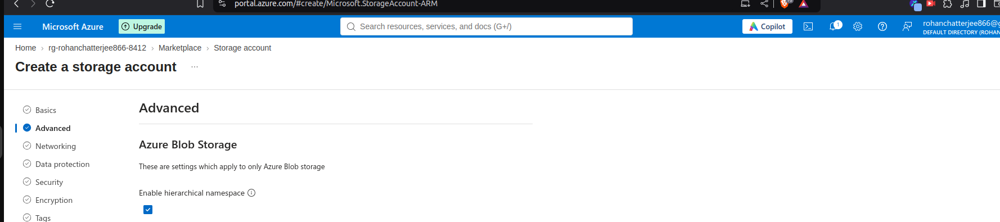

Its unified platform to interact with all AI LLMs or any operations or any blob storage.
 We can deploy our models too on it to.

So using Azure we create WS then using that workspace we can create multiple folders to work on.

Under a WS we have a project.

We can deploy the LLM can have preview for it

We have services called STT (Speech to Text) TTS(Text to Speech)

gpt-realtime-> Speech to Speech solution

# Azure-Microsoft-Foundary

##### In Case of RAG Foundary has Azure Ai Search

Which performs follwing things

- Search Engine
- Vector Search Engine
- Retrieval System

### Create Storage Account

### Account Details

#### In Adance Settings
